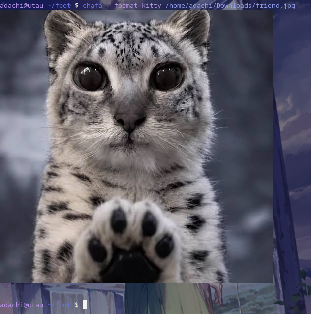

# foot (Patched by adachi)

This is a modified build of foot with Kitty Graphics Protocol support (`t=f`, PNG/RGBA, `c=`/`r=` sizing, chunked transfers).

For full documentation, configuration, and the original project, see:
https://codeberg.org/dnkl/foot

## Changes in this fork

- Kitty Graphics Protocol support via APC `ESC _ G … ST`
- Inline image rendering through the terminal image pipeline
- File-transfer medium (`t=f`, including fastfetch/chafa style workflows)
- `c=` / `r=` sizing support for placements
- Updated package build target: `foot-kgp`

## Example

